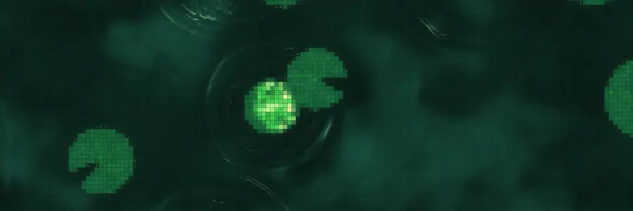

# ASCII Life Engine

Living creatures drawn in ASCII: butterflies that flap and glide, koi that bend around a turn and
come to food, jellyfish, dragonflies, frogs leaping between lily pads. One JavaScript file, no
dependencies, no build step. Made to be driven by AI coding agents.

## Quick prompt for your AI agent

Paste this into Claude Code, Codex, Cursor or any coding agent and replace the last line with what
you want:

```text
Clone https://github.com/howdeploy/ascii-life-engine and read AGENTS.md and
skill/ascii-life/SKILL.md before writing any code. Use the engine in ascii-life.js as is
(single file, ES5, no dependencies). After every visual change, render a still with
tools/render.js, look at it, and fix what is wrong before you report.

Task: add a full-screen koi pond behind the hero section of my site, reacting to the cursor.
```

Other tasks that work the same way:

- `Task: add a new creature — a heron that stalks slowly and strikes — as a new scene.`
- `Task: render a 10 second 1080p60 clip of the frog scene with these settings: {...}.`
- `Task: make a screensaver for my TV app from the jellyfish scene, tuned for a slow device.`

The repository ships the instructions the agent needs: [`AGENTS.md`](AGENTS.md) is the working
manual, [`skill/ascii-life/SKILL.md`](skill/ascii-life/SKILL.md) is the same knowledge packaged as
an installable skill.

## What you can do with it

- **Render graphics for TV.** Run it live as a screensaver or ambient screen inside a TV web app
  (it targets Chromium 85, the browser of 2022 Samsung TVs), or pre-render frame-exact video with
  the included tool.
- **Embed animations in websites.** A hero background, a loading state, a footer, a 404 page.
  The canvas can sit behind your content and still react to the cursor and to clicks.
- **Use it inside applications.** Any web view works: Electron and Tauri apps, dashboards, kiosks,
  chat UIs. Create it when the view opens, call `destroy()` when it closes.

## Try it

Open `index.html` in a browser. No server needed.

- Tabs switch between the five scenes; the panel on the right tunes everything live.
- **Copy** puts the current settings on the clipboard as JSON — paste them into your own page or
  hand them to your agent.
- Click the scene: koi get food, butterflies and dragonflies scatter, jellyfish take a shock wave,
  frogs jump away. The action is selectable.
- `←` `→` scene, `↑` `↓` palette, `H` hides the panels. The button in the panel header switches
  the interface between English and Russian.

## Use it

```html
<div id="stage" style="width:100%;height:100vh"></div>
<script src="ascii-life.js"></script>
<script>
  var life = new AsciiLife(document.getElementById('stage'), {
    scene: 'koi',          // butterfly | koi | jellyfish | dragonfly | frog
    palette: 'mix',        // koi palettes are breeds: kohaku, sanke, showa, ogon, chagoi
    waterMood: 'sun'       // leaves | clouds | sun | moon
  }).start();

  life.set({ count: 8, speed: 1.2 });   // change anything live
  // life.tap(clientX, clientY);        // trigger the scene's click action
  // life.destroy();                    // stop and clean up
</script>
```

Common options (the full list with comments is at the top of `ascii-life.js`):

| Option | Default | What it does |
|---|---|---|
| `scene` | `'butterfly'` | Which creatures to show |
| `count`, `size`, `speed` | scene default, `1`, `1` | How many, how big, how fast |
| `cols` | `150` | Grid density: cells across the width |
| `pointer` | `'flee'` | Hover reaction: `flee`, `attract`, `none` |
| `tapAction` | scene default | Click action: `food`, `scare`, `shock`, `splash`, `none` |
| `waterMood` | scene default | Pond lighting: `leaves`, `clouds`, `sun`, `moon` |
| `trail` | `0.18` | How long waves and haze linger |
| `bloom`, `blur` | `0.2`, `0` | Glow and softness |
| `background` | `'#06070a'` | Use `'transparent'` to overlay your own page |
| `fps`, `maxDpr`, `waterScale` | `30`, `1.5`, `1` | Performance: lower them on weak devices |

## How it works

The engine simulates the creature first and turns it into characters second, so what moves is the
animal, not a filtered picture of one.

1. **Mask.** Each scene draws its creatures with plain Canvas 2D paths into a tiny canvas where one
   pixel is one cell of the grid. Alpha is how much of the cell is covered, RGB is its colour.
2. **Owner map.** A second tiny canvas records which creature owns each cell. Glyphs and tile
   shading are placed in the creature's own coordinates, so the texture rides on the body. The same
   map fades far creatures into the background.
3. **Trail.** Pond scenes run a wave simulation; whatever touches the water disturbs it. Air scenes
   leave a haze that spreads and fades.
4. **Light.** The pond is a single WebGL shader: a bottom seen through the water, refraction and
   caustics only where a creature made a wave, shadows from leaves or clouds, sparkles on wave
   crests. Without WebGL the pond is skipped and everything else still runs.
5. **Cells.** A covered cell becomes a coloured tile with a glyph in a darker shade of the same
   colour. A partly covered cell becomes a glyph alone — that is how whiskers, antennae and
   tentacles stay thin.
6. **Post.** Bloom and blur from a small copy of the frame.

Creatures have depth (far ones are smaller and fainter), turn with inertia, keep their distance
from each other, and react to the pointer in proportion to their size. Koi have a spine of thirteen
bones with a bend limit per joint and a breed pattern generated per fish.

## Render a still or a video

```sh
npm i playwright-core
node tools/render.js '{"scene":"frog"}' frog.png            # one frame
node tools/render.js settings.json clip.mp4 600             # 10 s at 60 fps (needs ffmpeg)
```

Time is advanced by hand, exactly 1/60 s per frame, so a clip comes out the same on any machine.
Agents use the same tool to check their own work.

## Files

```
ascii-life.js          the engine and five scenes
index.html             demo with tweak panel (EN / RU)
tools/render.js        headless still and video renderer
AGENTS.md              manual for AI agents working on the engine
skill/ascii-life/      installable agent skill
```

## Credits

The look was inspired by the ASCII animal demos of Stephen Zhang (Pocket Studio). The engine is an
independent implementation; none of his code is used.

## License

MIT — see [LICENSE](LICENSE).
